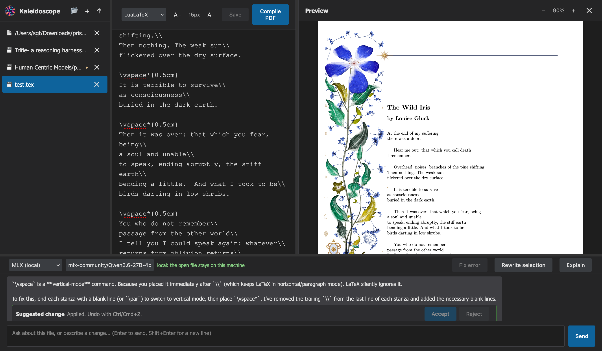

<p align="center"></p>

# Kaleidoscope

I got annoyed because I had adopted prism from openAI as a great overleaf relplacement, and then openAI killed it! 

So I thought: can I use AI to make a replacement?

Here it is, a web-based LaTeX editor that runs on your own machine: edit on the left, compile with pdfLaTeX, LuaLaTeX or XeLaTeX, read the PDF on the right, and ask a model of your choice (a local MLX server, Claude, or any OpenAI-compatible API) to fix errors or rewrite text. The main idea was to replicate prism, but with complete privacy and control of the models if desired. 

It runs in a docker container by default (it should be very easy to change this if you wanted), so you need docker desktop or something else that can run a docker container for you. 

## Features

- **Files** - open any `.tex`, `.bib`, `.sty`, `.cls`, `.bst`, `.txt` or `.md` file from a workspace folder on disk, or keep scratch files in the browser. Save writes back to disk; nothing is written until you press Save.
- **Editor** - a plain-text editor with command and environment completion (`\c` + Tab gives `\cite{}`), text zoom and resizable panes.
- **Compile** - pdfLaTeX, LuaLaTeX and XeLaTeX, chosen automatically or by you. A file is compiled together with its folder (`\input`, images, `.bib`), BibTeX and Biber run when needed, and passes repeat until references settle.
- **Preview** - the PDF is drawn in the page, fitted to the pane, with zoom.
- **Source and PDF together** - select text and the PDF moves to where it comes out; click the PDF and the editor moves to the line that made it.
- **History** - every Save records a version (Git underneath, in a hidden folder of the workspace). The History tab lists them, shows what changed word by word, and restores any version into the editor.
- **Assistant** - Fix error, Rewrite selection, Explain, or ask a question. You pick the provider and the model; answers stream in and suggested edits appear as diffs to accept or reject. For a model that can think first, a dial sets how long it may think.
- **Contained** - the server and TeX run in Docker, which sees one folder of yours and nothing else.
- **Mac app** - a Kaleidoscope app with an installer, for people who would rather not use a terminal.
- **Local first** - your files go to a model only if you pick a hosted provider, and the page says so.

## Quickstart

Kaleidoscope runs in a container: the server, TeX Live (pdfLaTeX, LuaLaTeX, XeLaTeX, BibTeX, Biber) and every document you compile stay inside Docker, and see only one folder of yours. You need no TeX installation.

**You need** Docker (Docker Desktop on macOS). For the assistant you also need Node.js 20 or later on your machine, with no packages; without it the editor and compiler still work.

**On a Mac, with the installer.** Open `Kaleidoscope-<version>.dmg`, drag Kaleidoscope onto Applications, and open it from there. A Terminal window starts it and your browser opens the editor; close that window to stop it. Your documents go in `Documents/Kaleidoscope`, which starts with an example. The `Read me first.txt` in the installer covers the rest, including what to do if macOS will not open an unsigned app. To make the installer, see [The Mac app](#the-mac-app).

**From the source**, on macOS or Linux:

```bash
git clone https://github.com/sgt101/Kaleidoscope.git
cd Kaleidoscope
./run_contained.sh
```

The first run asks a few questions about the assistant (see below), then builds the image (TeX Live: a few minutes and about 2 GB); later runs start in seconds. Open **http://localhost:3000**. Press Ctrl+C to stop.

1. **Open a file.** The workspace is the `documents/` folder next to the script. Click the folder icon at the top left to browse it and click a `.tex` file to open it, or use `+` to create a scratch file. To start with something that works, open `test.tex`, set the engine to LuaLaTeX and compile it: a poem in a box, with watercolour flowers grown in the margin by the [tikzflora](https://flora.alpacasoft.dev) package, whose files sit beside it.
2. **Compile.** Choose an engine (Auto, pdfLaTeX, LuaLaTeX, XeLaTeX) and press **Compile PDF**. Errors appear in the preview pane. Save (Ctrl/Cmd+S) writes the file back to the workspace folder.
3. **Ask the assistant.** It needs a model: see below. Then use **Fix error**, **Rewrite selection**, **Explain**, or type a question in the box at the bottom.

**Common options**

```bash
./run_contained.sh --work ~/papers     # use another folder as the workspace
./run_contained.sh --port 8080         # another port
./run_contained.sh --detach            # run in the background...
./run_contained.sh --stop              # ...and stop it again
./run_contained.sh --setup             # choose the assistant's models again
./run_contained.sh --rebuild           # rebuild the image from scratch
./run_contained.sh --open              # also open the editor in your browser when it is ready
./run_contained.sh --help              # everything the script can do
```

**Giving the assistant a model**

The first run sets this up. It looks for local model servers (MLX, LM Studio, Ollama, llama.cpp), any keys already set, and on a Mac Keychain items that look right, and asks which to use. It asks where your keys are kept, never for a key. Start your local model server first, so that it can be found. Run `./run_contained.sh --setup` to go through it again. See [Setup](#the-assistant).

- *Local (MLX):* start a server on your Mac, for example `mlx_lm.server --model mlx-community/Qwen3-8B-4bit --port 8081`. Choose other models in the box beside the provider menu. With `mlx_vlm.server`, also name the model: see [Choosing the model](#the-assistant).
- *Claude or OpenAI:* keep the key in your Mac's Keychain, or set it before starting (`ANTHROPIC_API_KEY=... ./run_contained.sh`), or put it in `.env` (copy `.env.example`). The key stays on your machine: it never enters the container. A hosted provider receives the open file; a local one does not.
- *More control* (token limits, timeouts, other services): edit the file setup saved. See [The assistant](#the-assistant).

**Packages that are not in TeX Live** (for example `tikzflora`) go in the same workspace folder as your `.tex` file, with any `.lua` files they use; the container compiles from a copy of that folder.

Prefer no Docker? See [Running without Docker](#running-without-docker).

## The Mac app

`mac/build.sh` makes Kaleidoscope.app, with the logo as its icon. Opening it starts Docker Desktop if needed, then runs `./run_contained.sh --open` in a Terminal window, so the first-run questions and the first build show there and the browser opens when the editor is ready. If Kaleidoscope is already running, the app only opens the browser. Closing the Terminal window stops Kaleidoscope.

```bash
mac/build.sh app --link    # ~/Desktop/Kaleidoscope.app, which runs this checkout and its documents/ folder
mac/build.sh app           # dist/Kaleidoscope.app, self-contained
mac/build.sh dmg           # dist/Kaleidoscope-<version>.dmg, an installer for other people
```

A `--link` app runs the checkout it was built from, so rebuild it if you move the folder. The installer holds a self-contained app (the program is inside it; its workspace is `~/Documents/Kaleidoscope`, which it fills with the example `test.tex` the first time), a link to Applications to drag it onto, and `Read me first.txt`, which lists what to install (Docker Desktop, and Node.js for the assistant). The app carries no keys, `.env` or provider list of yours, so each person goes through the assistant's setup on the first start.

Unsigned, the app makes each person allow it once in System Settings › Privacy & Security. To avoid that, set `SIGN_IDENTITY` to your Developer ID certificate and `NOTARY_PROFILE` to a `notarytool` profile before `mac/build.sh dmg`, which then signs and notarises it:

```bash
SIGN_IDENTITY="Developer ID Application: Your Name (TEAMID)" NOTARY_PROFILE=kaleidoscope mac/build.sh dmg
```

## Using Kaleidoscope

### Files

- **Open from disk:** the folder icon opens the workspace browser. Click folders (or the breadcrumbs) to move around and a text file to open it; arrow keys move through the list. Images and other non-text files are greyed out. You can create a file in the folder you are looking at.
- **Open files list:** the left panel lists the files you have open. A dot marks unsaved changes. `✕` closes a file opened from disk (the file on disk is kept) and deletes a scratch file.
- **Save:** the Save button or Ctrl/Cmd+S writes the open file to disk. Nothing is written before that. Saving a scratch file asks where in the workspace to put it, and from then on it is a disk file.
- **Scratch files:** `+` creates one and `↑` imports one from your computer. They live in your browser only.

The browser can only reach files inside the workspace folder. Paths that leave it (`..`, absolute paths, symlinks that point outside) and hidden files are refused.

### Compiling

- **Engine:** the Engine menu chooses pdfLaTeX, LuaLaTeX or XeLaTeX. **Auto** (the default) follows a `% !TEX program = lualatex` comment near the top of the file (as written by TeXShop, TeXworks and VS Code), and otherwise picks LuaLaTeX for documents that use `\directlua`, `luacode`, `fontspec`, `unicode-math` or `polyglossia`, and pdfLaTeX for everything else. The preview says which engine was used. Your choice is remembered.
- **Whole folder:** a file opened from disk is compiled together with the rest of its folder, so `\input`, `\includegraphics` and `.bib` files resolve. The server copies the folder (text, style, image, font, Lua and data files; subfolders included) to a scratch directory, so your folder gets no `.aux` or `.log` clutter. Unsaved edits in other open files of that folder are included, so the PDF matches what you see.
- **Passes:** TeX runs, then `bibtex` (for `\bibliography`) or `biber` (for `biblatex`) when needed, then TeX again until references settle (at most 5 passes). If the bibliography tool is missing, the PDF still builds and the preview says citations are unresolved.
- **Main file only:** compile the main file. A file with no `\documentclass` (one that is `\input` from elsewhere) is refused with an explanation.
- **Limits:** folders of more than 3000 files or 100 MB are refused (move the document into its own folder). Each pass may take 30 s (pdfLaTeX) or 120 s (LuaLaTeX, XeLaTeX). The first LuaLaTeX or XeLaTeX run builds a font cache and can take a minute; if it times out, try again.
- **Fonts:** for `\setmainfont` with LuaLaTeX or XeLaTeX, the container has open fonts only:
  - **Matches for common proprietary fonts**, with the same letter widths:

    | Instead of | Use |
    |---|---|
    | Arial | Liberation Sans |
    | Helvetica | TeX Gyre Heros |
    | Times New Roman | Liberation Serif |
    | Courier New | Liberation Mono |
    | Calibri | Carlito |
    | Cambria | Caladea |

  - **Others:** the rest of TeX Gyre and URW (such as Nimbus Sans), Noto Sans and Serif (many scripts, but not Chinese, Japanese or Korean), Open Sans, Roboto, Lato, Inter, EB Garamond, Linux Libertine O, Inconsolata, Fira Code, JetBrains Mono and DejaVu.
  - **Math, with `unicode-math`:** Latin Modern Math and the TeX Gyre math fonts, such as `\setmathfont{TeX Gyre Termes Math}`.

  `\setmainfont{Arial}` or `{Helvetica}` therefore fails in the container; the assistant knows the substitutes. Under XeLaTeX, families with many weights can pick too heavy a bold (Lato, Inter, JetBrains Mono); name it to fix that: `\setmainfont{Lato}[BoldFont={Lato Bold}]`. Nimbus Sans has no upright bold under XeLaTeX, so prefer TeX Gyre Heros. With pdfLaTeX, `\usepackage{helvet}` gives Nimbus Sans. To use another font in a document, put its `.ttf` or `.otf` files next to the document, with no spaces in their names (LuaLaTeX drops them), and name the files: `\setmainfont{MyFont.ttf}[BoldFont=MyFont-Bold.ttf]`.
- **Scratch files** have no folder, so they compile on their own.

### Moving between the source and the PDF

- **Editor to PDF:** select text and the PDF jumps to where it comes out, with a yellow mark over those words that fades after a couple of seconds. If only commands or options are selected, the mark goes to what those lines print.
- **PDF to editor:** click the PDF and the editor selects the word you clicked, opening its file if it is another one, such as a chapter pulled in with `\input`. Text the source does not spell out, such as a list number, goes to the nearest text that it does.

Both work after a successful compile, with all three engines. They match the text of the source against the text of the PDF, using the words around a place to tell repeated phrases apart, so they work for pages laid out with TikZ, where [SyncTeX](https://ctan.org/pkg/synctex) alone cannot see where anything is. SyncTeX separates places the text cannot and covers what has no text, such as images, where it is only as good as it is for that document. Text made by a macro, or printed differently from the source, may not be found. Identical text in two places can land on the wrong one. Because the text is matched, small edits since the compile do little harm. Scratch files work too. The PDF does not move while the History tab is showing.

### Line numbers and Tab

Each line of the file has a number beside it. A long line that wraps over several rows has one number, so the numbers match the line numbers in LaTeX's error messages.

**Tab** types a tab, shown four columns wide. With several lines selected it indents them all, and **Shift+Tab** takes one level off the selected lines, or the line with the caret: a tab, or up to four spaces. Ctrl/Cmd+Z undoes either. To leave the editor with the keyboard, press **Esc** and then Tab.

### Completions

Type a backslash and a letter (`\c`) and a list of matching commands appears at the caret, each with a short description. **↑ / ↓** choose, **Tab** inserts the command, with `{}` when it takes an argument and the caret placed inside (`\cite{|}`; `\frac` gives `\frac{|}{}`). **Esc** closes the list; typing on narrows it. Commands that take no argument (`\item`) are inserted as they are, and if the command is already followed by braces they are not added again. After `\begin{` or `\end{` the list offers environment names (`itemize`, `equation`, `tabular`, ...) and Tab also closes the brace. Nothing is offered inside a `%` comment. An inserted completion is ordinary typing: Ctrl/Cmd+Z undoes it. The lists are in `public/complete.js`; add your own there.

### Using the assistant

The bar under the editor talks to a model. Read the line beside the provider menu first: it says whether your file stays on your machine or is sent to a hosted service.

1. Pick a **provider** and a **model**.
2. **Fix error** (after a failed compile), **Rewrite selection** (select text, say in the box how to change it, press the button), **Explain** (the selection, the error, or the document), or type a question and press Enter. **Stop** cancels a running answer.
3. Each suggested change is a card showing the lines removed and added. **Accept** puts it into the editor (Ctrl/Cmd+Z undoes it), **Reject** drops it. Accepting changes the editor text only; Save writes it to disk. A card that says **Did not fit the file** can still be accepted: Accept looks again, so it works once the file has the text it needs. If you selected text before asking, your selection decides which place is meant when the text occurs more than once.
4. **Clear context** forgets the conversation and empties the chat, so the next question starts fresh. It helps when a small model gets stuck on something said earlier. The model still sees the open file, and the last compile error when it applies (see [What the model sees](#the-assistant)). Suggestions you have not accepted go too. Trifle keeps its conversation in its own session, so only the chat here is cleared.

See [The assistant](#the-assistant) under Configuration for providers, models and what the model is shown.

### History

Every Save of a workspace file records a **version**: a snapshot of the workspace's documents at that moment. Nothing to set up: it is on by default, needs Git (already in the container), and keeps its data in a hidden `.kaleidoscope/` folder inside the workspace, so it travels with your documents.

- **The History tab** sits beside Preview. It lists versions newest first, grouped by day. The menu chooses **This file**, **This folder** (the open file's folder) or **Everything**. A version that changed several files says how many, and hovering lists them.
- **Comparing:** select a version to see the open file's differences, with changed words highlighted and long unchanged stretches folded away. **Since then** compares that version with the text in the editor, unsaved edits included; **In this version** shows what that version itself changed. Line numbers are those of the newer text.
- **Restoring:** **Restore this version** puts the open file's text from that version into the editor. Ctrl/Cmd+Z undoes it, and it reaches disk only when you Save, which records it as a new version. Nothing is ever deleted from history.
- **Changes made elsewhere:** files changed by another editor, or while Kaleidoscope was not running, are recorded as **outside changes**, at startup or with your next Save, so a Save's version shows only what you saved.
- **What is kept:** the file types a compile uses (text, styles, bibliographies, images, PDFs, fonts, Lua and data files) up to 25 MB each. Hidden files, symbolic links and other types (Word, PowerPoint, zips) are left out. Git stores each distinct file once, compressed, so text history stays small.
- **Turning it off:** `HISTORY=off`. Deleting `.kaleidoscope/` deletes all history; your documents are untouched.

Named versions, compiled markers, folder restore and backups to other disks or a private Git remote are planned; see [docs/version-control.md](docs/version-control.md).

### Layout and zoom

- **Hide the file list or the chat:** the two buttons at the left of the editor header, or Ctrl/Cmd + `B` (file list) and Ctrl/Cmd + `J` (chat), to leave the editor and preview the whole window. A hidden pane's button is filled in; press it again to bring the pane back at its old size. The assistant keeps working while the chat is hidden.
- **Resize panes:** drag the bars between the file list, editor and preview, and the bar above the chat. Double-click a bar to reset it. With a bar focused, the arrow keys nudge it (Shift for bigger steps) and Home resets it.
- **Editor text size:** `A−` / `A+` in the editor header, or Ctrl/Cmd + `-` / `=` / `0` (or Ctrl + scroll) while typing. The size shown resets to 13px when clicked.
- **Preview zoom:** `−` / `+` in the preview header, or Ctrl + scroll (or trackpad pinch) over the preview. 100% fits the page to the pane width and follows the pane as you resize it; click the percentage to return to it. The PDF is redrawn at the new size, so it stays sharp.

Sizes, hidden panes, zoom, engine, provider and model are remembered in your browser.

### What is stored where

- **Browser (localStorage):** scratch files, copies of open workspace files and their unsaved edits, the chat, pane sizes, zoom, engine, provider and model. Files and chat survive closing the browser; the storage limit is typically 5 to 10 MB.
- **Workspace folder:** your real files, changed only when you press Save, and their history in the hidden `.kaleidoscope/history.git`.
- **Server:** nothing is kept between requests except which compiles and questions are running. Scratch build folders are deleted after each compile.

## Configuration

Settings come from the environment or from a `.env` file in the project folder (copy `.env.example`); real environment variables win. `run_contained.sh` reads the same `.env`.

| Variable | Default | Meaning |
|---|---|---|
| `PORT` | `3000` | port the server listens on |
| `HOST` | `127.0.0.1` | address to listen on; `0.0.0.0` exposes the compile endpoint to your network, so only behind your own authentication |
| `ALLOWED_HOSTS` | | extra host names the app may be reached by (comma separated), for a reverse proxy |
| `WORKSPACE_DIR` | `./documents` | the one folder the editor may list, open, save and compile |
| `SYNCTEX_PATH` | `synctex` on `PATH` | the SyncTeX program that links the source and the PDF |
| `HISTORY` | on | `off` stops recording versions |
| `HISTORY_DIR` | `.kaleidoscope/history.git` | where history is kept: absolute, or relative to the workspace |
| `GIT_PATH` | `git` on `PATH` | the Git program history uses (2.32 or later) |
| `MLX_URL`, `MLX_MODEL` | `http://127.0.0.1:8081/v1`, `default_model` | the built-in local provider |
| `ANTHROPIC_API_KEY`, `ANTHROPIC_MODEL` | `claude-sonnet-5-5` | adds Claude when the key is set |
| `OPENAI_API_KEY`, `OPENAI_MODEL`, `OPENAI_URL` | `https://api.openai.com/v1` | adds an OpenAI-compatible provider when the key and model are set |
| `PROVIDERS_FILE` | `./providers.json` | describe the providers in a file instead (below) |
| `BRIDGE_PORT`, `BRIDGE_HOST` | `8793`, `127.0.0.1` | where the [bridge](#the-assistant) listens on your machine |
| `BRIDGE_URL`, `BRIDGE_TOKEN` | | set in the container: the editor sends all model requests to this bridge. `./run_contained.sh` sets both, with a new token each run |
| `TRIFLE_URL`, `TRIFLE_TOKEN`, `TRIFLE_TOKEN_FILE`, `TRIFLE_TIMEOUT_MS` | see Trifle | the optional Trifle provider |
| `PDFLATEX_PATH`, `LUALATEX_PATH`, `XELATEX_PATH`, `BIBTEX_PATH`, `BIBER_PATH` | found on `PATH` | full paths, if the tools are elsewhere |

### The assistant

It is task oriented rather than a general agent: the editor decides what the model sees, the model replies with text and edit blocks, and nothing changes in your file until you press **Accept**.

**Providers.** Two wire formats cover most services: OpenAI-compatible chat (MLX `mlx_lm.server`, Ollama, llama.cpp, OpenAI, OpenRouter, ...) and Anthropic Messages (Claude). Without a `providers.json` you get:

- **MLX (local)** at `MLX_URL` (default `http://127.0.0.1:8081/v1`, model `MLX_MODEL`, default `default_model`);
- **Claude** when `ANTHROPIC_API_KEY` is set (model `ANTHROPIC_MODEL`, default `claude-sonnet-5-5`);
- **OpenAI** when `OPENAI_API_KEY` and `OPENAI_MODEL` are set;
- **Trifle** when a Trifle access token is found (see below).

**Setup.** The first `./run_contained.sh` from a terminal asks which providers to use and saves your answers in `~/.config/kaleidoscope/providers.json` (under `$XDG_CONFIG_HOME` if that is set), which is yours and outside the repository. No key is stored there. It tries the usual ports of MLX (8081), `mlx_lm.server` and llama.cpp (8080), LM Studio (1234) and Ollama (11434), and you can give the address of any other OpenAI-compatible server, including one that is not running yet. On a Mac it lists Keychain item names that look right and checks that the one you choose exists, without reading a password, so it brings up no prompt. On Linux keys come from the environment or `.env`. `./run_contained.sh --setup` asks again and keeps the previous file as `providers.json.bak`. Ctrl+C leaves everything as it was. With no terminal, or with `PROVIDERS_FILE` set, there is no first-run setup.

The list comes from the first of these that exists: `PROVIDERS_FILE`, the file setup saved, `providers.json` in the repository, the built-in list above.

For anything setup does not ask about, edit the saved file, or copy `providers.example.json` to a file of your own and point `PROVIDERS_FILE` at it. It holds a list of `{ id, label, kind, url, model, keyEnv, contextChars, maxTokens, temperature, extraBody, thinking, timeoutSeconds }`, where `kind` is `openai`, `anthropic` or `trifle`. A key is never written in the file: `keyEnv` names the environment variable that holds it, and on a Mac the optional `keychain` names the Keychain item that does, if that is not the same name. The key stays on your machine, never in the browser or the container. The provider menu shows which are ready (a local server is probed; a hosted one needs its key). The line beside it says where your text goes: a local provider keeps the open file on your machine, a hosted one **sends the open file to that service**, so pick accordingly.

`extraBody` adds fields of your own to each request the provider is sent, for settings a server takes that Kaleidoscope does not set, such as `{ "top_k": 20 }`. It cannot set `model`, `messages`, `system`, `stream` or `max_tokens`, which Kaleidoscope sets itself, and a provider's own `temperature`, if it has one, wins over one here.

`thinking` is for a model that can think before it answers, slower but more carefully. It gives the request fields that turn thinking on and off, and with it the chat shows a **thinking dial** left of the input box. For a Qwen model on an MLX server, with the sampling settings Qwen suggests for each:

```json
"thinking": {
  "on":  { "enable_thinking": true,  "temperature": 1.0, "top_p": 0.95, "top_k": 20 },
  "off": { "enable_thinking": false, "temperature": 0.7, "top_p": 0.8,  "top_k": 20, "presence_penalty": 1.5 }
}
```

The dial sets how long the model may think, from **Off** (it answers straight away) up to 10 minutes in steps of 30 seconds: drag it up or down, scroll on it, or focus it and use the arrow keys (Home is Off). The browser remembers the setting. While the model thinks, its reply shows the time it has taken and the time it has; the thinking itself is not shown. When the time is up, Kaleidoscope stops it and asks the model again, with thinking off and its thinking so far, for the answer. That takes a moment more, as the document is sent again. The time is measured, not estimated from tokens, so it holds on any server; an MLX server run with a draft model (`--draft-model`) refuses its own `thinking_budget`, so a limit there has to come from Kaleidoscope. Running setup again keeps `extraBody` and `thinking`.

```json
{
  "default": "mlx",
  "providers": [
    { "id": "mlx", "label": "MLX (local)", "kind": "openai", "url": "http://127.0.0.1:8081/v1",
      "model": "default_model", "maxTokens": 16384, "timeoutSeconds": 300 },
    { "id": "claude", "label": "Claude", "kind": "anthropic", "model": "claude-sonnet-5-5", "keyEnv": "ANTHROPIC_API_KEY" }
  ]
}
```

**Choosing the model.** The box beside the provider menu is the model that answers. Its drop-down lists what the provider reports (`/models`): for MLX, the models in your Hugging Face cache; for Claude, OpenAI and OpenRouter, their catalogues. You can also type any name. An MLX server loads the model a request names, so typing a Hugging Face repo such as `mlx-community/Qwen3-8B-4bit` switches to it; the first question after a switch waits while it loads (if that takes over two minutes, raise `timeoutSeconds`). The choice is remembered per provider in your browser; clear the box to go back to the provider's configured model (`MLX_MODEL`, or `model` in `providers.json`).

**`mlx_vlm.server` and speculative decoding.** `default_model` means "whatever `--model` loaded" only to `mlx_lm.server`. `mlx_vlm.server` has no such name, so with it set `MLX_MODEL` or `model` in `providers.json` to the real repo, or an empty box will fail. If you run it with `--draft-model`, the MTP repo is a draft head and not a model that can answer: repos with `MTP` in their name are left out of the drop-down, and naming one makes the server drop the real model. The draft is fixed when the server starts and is made for one main model, so keep to that model in the box.

**Thinking models.** Models that think before answering can use their whole token allowance on thinking and send no answer. The error then says so ("used all N tokens thinking"); raise `maxTokens` for that provider (the default is 4096) or pick a model that does not think. Models that print reasoning as `<think>...</think>` have it hidden.

**Tasks.** The buttons above the chat start a task with its own instructions and context; typing in the box asks a free question about the file.

| Task | What it does |
|---|---|
| **Fix error** | enabled after a failed compile; the model gets the error and the source around each `l.N` line, and proposes the smallest fix, or says the cause is elsewhere |
| **Rewrite selection** | select text, say in the box how to change it, press the button; one change replaces exactly the selection |
| **Explain** | explains the selection, or the compile error, or the document; never proposes edits |
| (ask) | any question; changes are proposed only if you ask for one |

**What the model sees.** Always the same, built by the editor: the file name; the document with line numbers (so `l.113` in a log points at a real line); your selection with its line range; and the file's last compile error, for Fix error, Explain, and a typed question that mentions it (a word such as error, compile, fail, fix, warning or undefined). A file keeps its error until a compile succeeds, so otherwise it would follow every question and small models fix on it. A document too large for the provider's `contextChars` (32000 unless set; setup gives a local server 100000 and a hosted one 400000) is cut down to the preamble, the neighbourhood of the selection, cursor and, when the error is sent, its lines, and an outline, with the gaps marked. The last eight messages of the conversation go along (**Clear context** empties them); nothing else from your machine does. In the container, every system prompt also says that the tools run there and what is missing (TeX Live is a partial install, only the fonts listed under [Compiling](#compiling), only the main file's folder, no shell escape), so that the model considers this first when something cannot be found. The image turns this on with `KALEIDOSCOPE_CONTAINER`; the list is `CONTAINER_NOTE` in `assistant.js`.

**Edits.** The model proposes changes as search/replace blocks. Each becomes a card showing the lines removed and added, with **Accept** and **Reject** (and **Accept all** for several). A block applies only where its text occurs exactly once in the file; if a block does not fit, the model is told once and asks again, and a block that still does not fit is shown as not applicable. Accepting changes the editor's text only, through the text field's own undo stack; it is saved to disk only when you press Save. The assistant edits the open file and no other. Because it cannot run commands or write files, a hostile document that says "ignore your instructions" can at worst produce a change you reject.

**Streaming and Stop.** Answers stream in; **Stop** cancels the request to the model. A model that goes silent for two minutes (`timeoutSeconds` to change it) is given up on. One question is answered at a time.

**The bridge.** In the container, the editor never talks to a model or holds a key. `./run_contained.sh` starts a small program on your machine, `bridge.js`, and stops it with the container. The bridge reads the provider list, `MLX_URL` and the rest of the provider settings, and your keys, from your machine's environment and `.env`. It tells the editor what providers there are, adds the real key to each chat request, sends it to your MLX server or the hosted API, and streams the answer back. Because the bridge runs on your machine, `127.0.0.1` in a provider's URL means your machine, so a model server needs no special address.

The container holds only `BRIDGE_TOKEN`, made new for each run. It works on nothing but the bridge, and the bridge uses it for one thing: the chat call of a provider you have configured. It cannot read a key back, or reach any other address or path. The bridge needs Node on your machine, but no packages. Its log, which records provider names and HTTP statuses and never your text, is in `~/.config/kaleidoscope/bridge.log`. A key or provider list changed while it runs takes effect the next time you start `./run_contained.sh`.

**Keys in the Keychain.** For a provider's key, the bridge looks in the environment, then `.env`, then on a Mac the Keychain: a password item whose *service* is the provider's `keychain`, or `keyEnv` if it has none. Setup fills this in, and it looks like this:

```json
{ "id": "claude", "label": "Claude", "kind": "anthropic", "model": "claude-sonnet-5-5",
  "keyEnv": "ANTHROPIC_API_KEY", "keychain": "anthropic-api-key" }
```

The service is what Keychain Access shows under **Where**, usually the same as the item's name. To list every item's service, without any passwords:

```bash
security dump-keychain | grep '"svce"'
```

To add an item from a terminal, without the key appearing in your shell history (it prompts for the password):

```bash
security add-generic-password -s ANTHROPIC_API_KEY -a "$USER" -w
```

The bridge reads the keys once as it starts, with macOS's own `security` tool, and keeps them only in its memory. The first time, macOS asks whether `security` may use the item: **Always Allow** stops it asking again, while **Allow** asks at every start. If a key cannot be read, the provider shows as not ready, and the bridge's log says whether the item was missing or the prompt went unanswered. Keychain lookup is in the bridge only, so `npm start` still needs the key in the environment or `.env`.

With Docker Compose, start the bridge yourself: put a long random `BRIDGE_TOKEN` in `.env`, then run `node bridge.js` beside `docker compose up`. Running without Docker (`npm start`) there is no bridge: the server is already on your machine, and calls providers itself.

**Trifle** is available as one provider. It is used when a token is found (`TRIFLE_TOKEN`, `TRIFLE_TOKEN_FILE`, or `~/.config/trifle/token`) at `TRIFLE_URL` (default `http://127.0.0.1:8792`, then `:8787`). It has its own model and tools, takes the whole prompt as one message with no streaming, and its conversation lives in Trifle's session. From the container its bridge must accept the name `host.docker.internal` (`--allow-host host.docker.internal`). A failure (token rejected, not reachable, too slow after `TRIFLE_TIMEOUT_MS`) is shown as one.

## Running without Docker

Use this if you want to work on a trusted set of documents with your own TeX installation, or to develop Kaleidoscope. See [Security](#security) first: without the container, LuaLaTeX documents can read files your account can read.

**You need** Node.js 20.12 or newer and a TeX distribution. `pdflatex` is required; `lualatex`, `xelatex` and `biber` are used when present.

```bash
brew install --cask mactex              # macOS; or: sudo apt-get install texlive-full biber   (Debian/Ubuntu)
npm install
npm start                               # http://localhost:3000
```

- On Windows install [MiKTeX](https://miktex.org/) or [TeX Live](https://www.tug.org/texlive/) and make sure `pdflatex` is on your `PATH`.
- A smaller TeX (BasicTeX, `texlive-latex-base`) works, but packages your documents use must then be installed (`tlmgr install <package>`).
- `npm run dev` restarts the server when files change.
- On start the server prints which providers and TeX tools it found and which folder is the workspace. If a tool is not found, set its `*_PATH` variable.
- Settings go in `.env` (see [Configuration](#configuration)). `npm start` serves `documents/` unless `WORKSPACE_DIR` says otherwise.

## Architecture

### The screen

<table>
<tr>
<td width="55%" valign="top">



</td>
<td valign="top">

```
┌────────────────┬──────────────────────────┬───────────────────┐
│ Kaleidoscope   │ Engine  A-  A+  Save     │ Preview  History  │
│ open  new  up  │ [ Compile PDF ]          │                   │
├────────────────┤                          │                   │
│ Open files     │ Text editor              │ PDF preview       │
│                │ (textarea) with          │ (PDF.js), zoom    │
│ notes.tex      │ command completion       │ to fit the pane   │
│ refs.bib       │                          │ or History:       │
│                │                          │ versions, diffs   │
├────────────────┴──────────────────────────┴───────────────────┤
│ Provider Model status [Fix error] [Rewrite] [Explain] [Clear] │
│ Chat: answers stream in; suggested edits appear as diffs      │
│ with Accept / Reject                                          │
│ [ Ask about this file, or describe a change...  ]  [Send]     │
└───────────────────────────────────────────────────────────────┘
```

</td>
</tr>
</table>

The page has three panes above an assistant bar. All of it is one static page (`public/index.html`) and a few scripts; the panes are separated by draggable bars.

| Area | What it is |
|---|---|
| **Open files** (left) | the files you have open, with a dot on unsaved ones, and buttons to browse the workspace, create a scratch file and import one |
| **Editor** (middle) | a plain `<textarea>` with line numbers; its header holds the engine menu, text size, Save and Compile PDF; completions appear at the caret |
| **Preview / History** (right) | two tabs: the compiled PDF drawn with PDF.js (or the compile error), with zoom controls; and the version list with a word diff and Restore |
| **Assistant** (bottom) | provider menu, model box, a status line (local or hosted), the three task buttons and Clear context, the conversation with suggested edits as diff cards, the thinking dial (for a provider with `thinking`), and the input box |

### System overview

```
┌─ Browser  (public/, served by the server as static files) ───────────────────────┐
│ index.html, styles.css   the page: no framework, no build step                   │
│ app.js                   UI and state, compile and chat clients, panes, zoom     │
│ complete.js              command and environment completions                     │
│ lines.js                 line numbers, and what Tab does                         │
│ edits.js                 edit-block parser (also used by the server)             │
│ diff.js, history-view.js the History tab: versions, word diffs, restore          │
│ sync.js, pdftext.js      selecting moves the PDF, clicking it moves the editor   │
│ PDF.js                   draws the compiled PDF (loaded from cdnjs)              │
│ localStorage             open files, chat, layout, zoom, engine, provider, model │
└──────────────────────────────────────────────────────────────────────────────────┘
            ▲ ▼  same-origin HTTP on 127.0.0.1: JSON, PDF bytes, NDJSON stream
┌─ Node server  (server.js, Express; its only runtime dependency) ─────────────────┐
│ /api guard      Host allow-list and same-origin check on every API call          │
│ /api/fs/*       list, read and save text files            → workspace            │
│ /api/compile    scratch copy, engine passes, bibliography → TeX tools            │
│ /api/assistant  providers, readiness, model names         → providers.js         │
│ /api/chat       task → context → model → checked edits    → assistant.js         │
│ /api/history/*  versions, file at a version, status       → history.js, git      │
│ /api/sync/*     source line to PDF point and back         → synctex.js           │
└──────────────────────────────────────────────────────────────────────────────────┘
            ▼                         ▼                             ▼
              files                     child processes               HTTP
┌─ Workspace ──────────┐ ┌─ TeX tools ────────────┐ ┌─ Model providers ────────────┐
│ one folder of your   │ │ pdflatex               │ │ MLX or Ollama (local)        │
│ .tex, .bib, images   │ │ lualatex, xelatex      │ │ Claude, OpenAI-style APIs    │
│ and data files       │ │ bibtex, biber          │ │ Trifle bridge                │
│ (WORKSPACE_DIR)      │ │ in a scratch folder    │ │ in the container, reached    │
│ .kaleidoscope/ (Git) │ │ git, synctex           │ │ through bridge.js, with keys │
└──────────────────────┘ └────────────────────────┘ └──────────────────────────────┘
```

Kaleidoscope is a small client-server application. The browser holds the editing state and does everything that needs the screen: editing, completion, PDF drawing and applying edits. The server is the only part that touches files, TeX and model services, and it does so on the browser's behalf through a handful of JSON endpoints. There is no database and no build step; the only runtime dependency is Express.

### Components

| File | Runs in | Responsibility |
|---|---|---|
| `server.js` | Node | HTTP server and all endpoints: the request guard, workspace file API, compile pipeline, assistant endpoints, startup report |
| `providers.js` | Node | the model layer: loads the provider list, probes readiness, lists model names, streams a completion over the OpenAI or Anthropic wire format, applies the idle timeout and abort |
| `assistant.js` | Node | the assistant's tasks: system prompts per task, the deterministic context builder, history trimming, `<think>` filtering, and the retry when a proposed edit does not fit |
| `setup.js` | Node, on your machine | the first-run questions: finds local servers and keys, and saves your provider list. Not in the image |
| `bridge.js` | Node, on your machine | outside the container, holds the provider list and keys, and passes the container's chat requests on to providers |
| `trifle.js` | Node | client for the optional Trifle bridge |
| `public/app.js` | Browser | application state and persistence, file list and workspace browser, compile client and PDF rendering, assistant client and edit cards, pane layout and zoom |
| `public/complete.js` | Browser | command and environment completions: matching, insertion rules and the popup (its logic is plain functions, tested in Node) |
| `public/lines.js` | Browser | the line numbers beside the editor, and what Tab and Shift+Tab do to the text (tested in Node) |
| `public/edits.js` | Both | the edit-block format: parse, locate, apply and check; the server uses it to verify a proposal, the browser to show and apply it |
| `history.js` | Node | version history: runs Git with a hardened environment, walks the workspace, records versions, reads the log and files at a version |
| `public/diff.js` | Both | line and word diffs (Myers, with unique-line anchoring for large changes); shown in the browser, tested in Node |
| `public/history-view.js` | Browser | the History tab: version list, diff view and restore |
| `synctex.js` | Node | keeps the SyncTeX record of the last few compiles, runs the `synctex` program, translates between compile-folder names and workspace paths, and lists a compile's files |
| `public/pdftext.js` | Both | matches the source to the PDF by their text: reduces LaTeX and PDF text to letters and digits, keeps where each came from, and finds a place by the text around it; used in the browser, tested in Node |
| `public/sync.js` | Browser | follows the selection into the PDF and marks it, and turns a click on the PDF into words in the editor, falling back on SyncTeX |
| `run_contained.sh`, `Dockerfile` | host | build the image and start the container with the isolation flags |
| `test/` | Node | unit tests (`npm test`) for edits, providers, setup, the assistant, completions, diffs, history and SyncTeX |

### How a compile works

1. The browser posts the text **in the editor** (not the saved copy), the engine, and, for a file opened from disk, its workspace path and the unsaved text of the other changed files (`overrides`).
2. The server refuses if two compiles are already running (HTTP 503), picks the engine (your choice, a `% !TEX program` comment, Lua or `fontspec` markers, otherwise pdfLaTeX) and refuses a file without `\documentclass`.
3. It creates a scratch directory and copies the main file's folder into it: only regular files with a known extension, no hidden files, no symlinks that leave the workspace, at most 3000 files, 100 MB and eight levels. The unsaved overrides are written over the copies, and the main file is written as `document.tex`.
4. It runs the engine with `-interaction=nonstopmode -halt-on-error -no-shell-escape -synctex=1` and a bare environment (only `PATH`, `HOME` and TeX's paranoid file-access settings), killing it on timeout.
5. If the log shows a bibliography is needed (`\bibdata` in the `.aux`, or a `.bcf` file) it runs `bibtex` or `biber`, then reruns the engine while TeX asks for another pass, up to five passes in all.
6. On success it keeps the SyncTeX record and returns the PDF bytes with `X-Compile-Engine`, `X-Compile-Sync` and `X-Compile-Notes` headers; on failure JSON with the TeX errors extracted from the log (`!` lines, and errors raised in Lua code). The scratch directory is deleted either way.
7. The browser hands the PDF to PDF.js, draws each page to a canvas at pane width times zoom, and swaps the pages in together; a newer render (another zoom step, a resize) cancels an older one. A failure is kept for that file, which is what enables **Fix error**.

### How an assistant request works

1. The browser sends the provider, the optional model, the task, your message, the last messages of the chat, the **whole open file**, the selection and cursor offsets, and the last compile error of that file.
2. The server checks the request (one question at a time, HTTP 409 otherwise) and opens a streaming response of newline-delimited JSON. If the browser disconnects, the upstream model request is aborted.
3. `assistant.js` builds the prompt: the task's instructions plus the edit-block format, then a user message holding the numbered document (cut down around the selection, cursor and error lines if it exceeds the provider's `contextChars`), the selection, and the compile error for Fix error, Explain and a typed question that mentions it.
4. `providers.js` streams the model's answer (`/chat/completions` or `/v1/messages`), and the text is forwarded as it arrives, with `<think>` blocks removed.
5. When the answer is complete the server checks every edit block against the document. A block must find one place: an exact match first, then one differing only in trailing spaces and line endings, then one differing in spacing, indentation, quotes, dashes or accents. The selection, if there was one, picks between several places. Blocks are tried in turn, each on the result of the ones before, and then on the original document, because a model writes them all from the file it was shown. If one still does not fit, the model is told what was wrong and asked once more; blocks that fail again are reported to the browser.
6. The browser parses the answer into text and edit blocks, shows each block as a diff card, and on **Accept** applies it to the text field through `document.execCommand`, so the browser's own undo history records it. Accept always locates the text again in the editor as it is then, so a block reported as not fitting is not ruled out for good, and one that fitted can turn out not to. Nothing is saved until you press Save.

### How history works

1. At startup the server checks Git (2.32 or later), creates `<workspace>/.kaleidoscope/history.git` if needed (a bare repository, never your own `.git`), and records anything that changed while it was not running.
2. After a Save writes the file, the server records a version in the background; Save never waits for it or fails because of it. One version is recorded at a time.
3. To record one, it walks the workspace with the compile's file-type rule, hashes only files whose size or time changed (`git hash-object --no-filters`, with its own cache), builds the tree in a private index (`update-index --index-info`, `write-tree`), and compares it with the latest version. If the saved file and other files changed, the other changes are committed first as "outside changes". Each version is a `commit-tree` with `Kaleidoscope-Reason` and `Kaleidoscope-Path` trailers, and `update-ref` moves `main` only if no other version got there first.
4. The History tab asks for the log of a file, folder or everything (`git log` with a literal pathspec) and for a file's text at a version. The word diff is computed in the browser by `public/diff.js`.
5. Restore is done in the browser: the version's text replaces the editor's through the same undoable path as an accepted assistant edit.

### Data and state

| Where | What | Lifetime |
|---|---|---|
| Browser `localStorage` | `latexFiles` (scratch files, and open workspace files keyed `ws:<path>` with their unsaved text), `currentFile`, `dirtyFiles`, `chatHistory`, `engine`, `provider`, `model:<id>`, `layout`, `zoom` | until cleared |
| Browser memory | the last compile error per file, the loaded PDF, the running assistant request | the page |
| Server memory | the provider list (read at start), counters for running compiles and questions, short caches of provider readiness (3 s) and model lists (3 s local, 60 s hosted) | the process |
| Workspace folder | your files | changed only by Save |
| `.kaleidoscope/history.git` in the workspace | versions (a bare Git repository), plus a cache of file sizes and times | until you delete it |
| Scratch directories | one per compile, in the system temp folder | deleted after the compile |
| SyncTeX records | the `document.synctex.gz` of the last five compiles, in the system temp folder | replaced by later compiles |
| `HOME` of the server | TeX font and parse caches (LuaLaTeX, XeLaTeX, Biber), kept so that they are not rebuilt on every compile; in the container a named volume | persistent |

### Security

Kaleidoscope is a single-user tool for your own machine. It has no accounts and no authentication, so its protections are about keeping it local and keeping documents contained.

- **Local only.** The server listens on `127.0.0.1` (`HOST` to change). Every `/api` call must carry a `Host` of `localhost`, `127.0.0.1` or `[::1]` (or an `ALLOWED_HOSTS` name) and, if it has an `Origin`, the same one. That stops other sites in your browser, including DNS-rebinding tricks, from using the compile endpoint. No CORS headers are sent. Only `public/` is served: the server code, `.env` and your documents are not.
- **Workspace jail.** Every path from the browser is resolved with `realpath` and must stay inside the workspace folder, so `..`, absolute paths and links pointing outside are refused, as are hidden files. Only text file types can be opened or saved, up to 2 MB.
- **Compiling.** TeX runs with `-no-shell-escape`, in a scratch copy, with file access limited to that folder (`openin_any=p`, `openout_any=p`), a bare environment and a timeout. **LuaTeX is the exception for reading:** Lua code in a document (`\directlua`) can read any file your user account can, and write to nothing outside the build folder. Compile only documents you trust, or use the container.
- **History.** Git is run like TeX: no shell, an argument array, a timeout, capped output, and an environment that ignores system and user Git settings and turns off hooks and `fsmonitor`. The history repository is bare and Git is never given a work tree, so `.gitattributes` files in your folders cannot attach filters, and file contents are read with `--no-filters`. Its config is rewritten at every start, because a folder copied from elsewhere could carry a planted `.kaleidoscope` with commands in its config. Paths from the browser are checked (no `..`, no hidden or absolute paths) and passed as literal pathspecs after `--end-of-options`; version ids must be 40 hex characters. A test plants a filter, a textconv, an `fsmonitor` command and hooks and checks that none runs.
- **SyncTeX.** The browser sends a compile id, a file and a line, or a page and a point. Lines and pages must be whole numbers, and a file must be one that compile read, so no name from the browser reaches the `synctex` program, and only files of the project come back.
- **Keys.** API keys are read from the environment, `.env` or the macOS Keychain on your machine and never sent to the browser. When the editor is contained they never enter the container: only the [bridge](#the-assistant), outside it, has them. The container's bridge token works only on the bridge, which answers it with a provider list holding no keys and passes on only chat calls to configured providers. Anything else, or any other token, is refused, and only `/health` answers without one. The bridge listens on `127.0.0.1` (on Linux, the Docker bridge network's gateway address).
- **Your text and models.** A local provider keeps the open file on your machine. A hosted provider receives the open file (up to the context limit) and the last chat messages; the page shows which kind is selected. The assistant can only return text: it cannot run commands, read other files or write files.

### The container

`./run_contained.sh` builds an image (`node:20-bookworm` plus TeX Live with LuaLaTeX, XeLaTeX, BibTeX and Biber, the fonts listed under [Compiling](#compiling), and Git for history) containing only the app, not your documents or secrets, and runs it with:

- a **read-only root filesystem**, a 512 MB tmpfs for `/tmp`, **no Linux capabilities**, `no-new-privileges`, a non-root user, and limits of 2 GB memory, 2 CPUs and 512 processes;
- one **bind mount**: the workspace folder, read-write so that Save works (`/` and your home folder are refused as workspaces), and a named volume for TeX caches;
- the page **published on `127.0.0.1` only**;
- **no API keys and no provider settings**: only the address of the [bridge](#the-assistant) on your machine and a token for it, and Trifle's token if you use Trifle.

A document compiled there, even a LuaLaTeX one, cannot see your home folder or your keys. `docker-compose.yml` is an alternative way to start the same image; you start the bridge yourself.

### Design decisions

- **One folder, one server, no build step.** The page is plain HTML, CSS and JavaScript served as static files, so there is nothing to bundle and the whole front end can be read in an afternoon.
- **The browser is the source of truth while you edit.** Compiles and assistant requests use the text in the editor, not the file on disk, and nothing reaches disk without Save.
- **A task-oriented assistant, not an agent.** The model gets a fixed context built by the editor and can only answer with text and edit blocks. That keeps behaviour predictable, keeps the model unable to touch anything but the open file, and works with small local models.
- **Edits are search/replace blocks, not whole files.** A block is short, can be checked against the document by the server before you see it, and is shown as a diff you can accept one change at a time.
- **Providers are data.** A new OpenAI-compatible service is a few lines in `providers.json`; only a new wire format needs code.
- **Containment over permissions.** Rather than trying to make TeX safe on the host, the supported way to compile documents you did not write is to give the whole stack a throwaway root filesystem and one shared folder.

### Known limits

- Single user, no authentication; do not expose it to a network.
- One assistant question at a time for the whole server, and at most two compiles at once.
- The PDF viewer (PDF.js) is loaded from `cdnjs.cloudflare.com`, so the page needs internet access the first time it loads.
- The editor is a plain `<textarea>`: no syntax highlighting, and completions know commands and environments but not your labels or citation keys.
- Scratch files and chat live in browser storage, which is limited in size and local to that browser.
- The source and the PDF are matched by their text, so macro-generated text may not be found, and identical text in two places can land on the wrong one.
- History covers workspaces of up to 20,000 kept files. Old versions are never thinned yet, and history is not yet copied anywhere else: a backup of the workspace folder includes it.

## API reference

All endpoints are under `/api`, are same-origin only, and answer errors as JSON (`{ "error": "...", "details": "..." }`).

### GET `/api/fs/list?path=<folder>`

Lists a workspace folder (empty path: the root): `{ path, root, entries: [{ name, type: "dir" | "file", size, editable }] }`, folders first.

### GET `/api/fs/file?path=<file>`

Reads a text file: `{ path, content }`. Status 415 for other file types or binary content, 413 above 2 MB.

### PUT `/api/fs/file`

Saves or creates a text file: body `{ "path": "notes/chapter1.tex", "content": "..." }`, answer `{ path, saved: true }`. A version is recorded afterwards in the background.

### GET `/api/history/status`

`{ enabled, reason }` when history is off; otherwise `{ enabled: true, dir, git, versions, latest, busy, error }`, where `latest` is a version as below, `busy` means versions are still being recorded, and `error` is the last recording failure.

### GET `/api/history/log?path=<file or folder>&limit=50&before=<version>`

Versions that changed `path` (empty: everything), newest first: `{ versions: [{ id, parent, time, subject, reason, paths, fileCount, files: [{ status, path }] }], more }`. `reason` is `save`, `external` or `first`; `paths` are the saved files; `files` lists every file the version changed (`A`, `M`, `D`; at most 100). `before` continues a list after that version. It waits up to 5 s for versions still being recorded.

### GET `/api/history/file?path=<file>&version=<version>`

A file as it was in a version: `{ path, version, content }` for text up to 2 MB, `{ ..., binary: true, size }` otherwise, or `{ ..., missing: true }` if the file was not in that version. Status 400 for a bad path or id, 404 for an unknown version, 503 when history is off.

### POST `/api/compile`

```json
{
  "texContent": "\\documentclass{article}...",
  "engine": "auto",
  "path": "papers/main.tex",
  "overrides": { "papers/intro.tex": "unsaved text" }
}
```

`engine` is `auto`, `pdflatex`, `lualatex` or `xelatex`. `path` and `overrides` are optional: with `path` the file's whole folder is compiled. **Response:** `application/pdf` with `X-Compile-Engine`, `X-Compile-Sync` (the id for `/api/sync/*`, when there is a record) and an optional URL-encoded `X-Compile-Notes`; or JSON with `details` holding the TeX errors (400 for a bad request, 503 when busy, 500 when compilation fails).

### GET `/api/sync/view?id=<compile>&path=<file>&line=<n>&endLine=<n>`

Where lines of a file appear in the PDF: `{ rects: [{ page, x, y, w, h }] }` in PDF points from the top left of the page, in page order. An empty `path` means the main file; `endLine` is optional, and at most 30 lines are looked up. An unknown compile, a file that compile did not read, or a bad line gives an empty list.

### GET `/api/sync/files?id=<compile>`

The other project files that compile read, as workspace paths: `{ files }`. The browser searches their text for a clicked word.

### GET `/api/sync/edit?id=<compile>&page=<n>&x=<points>&y=<points>`

The source of a point on a page: `{ main: true, line }` for the main file, `{ path, line }` for another workspace file, or `{}` when it did not come from a file of the project.

### GET `/api/assistant`

The configured providers and whether each is ready: `{ providers: [{ id, label, kind, model, models, local, host, ready, detail }], default }`, where `model` is the configured default and `models` the names the provider offers (empty when it cannot say).

### POST `/api/chat`

Ask the assistant about the open file. The reply is a stream of newline-delimited JSON.

```json
{
  "provider": "mlx",
  "model": "mlx-community/Qwen3-8B-4bit",
  "task": "ask",
  "message": "Make the abstract shorter",
  "history": [{ "role": "user", "content": "..." }],
  "texContent": "\\documentclass{article}...",
  "fileName": "main.tex",
  "selStart": 0, "selEnd": 0, "cursor": 0,
  "compileError": "",
  "thinkingSeconds": 120
}
```

`task` is `ask`, `fix`, `rewrite` or `explain`. `model` is optional and replaces the provider's configured model for this question. `thinkingSeconds` (0 to 600, 0 for no thinking) is how long a provider with `thinking` fields may think; left out, the provider's own default stands.

**Response:** lines of `{"type":"text","text":"..."}` as the answer arrives, `{"type":"reset","text":"..."}` when it is replaced, `{"type":"retry","reason":"..."}` when an edit did not fit and the model is asked again, `{"type":"thinking","seconds":120}` once when the model starts thinking (`seconds` 0 when there is no limit), `{"type":"thinking-over"}` when its time ran out and it is asked for the answer, then `{"type":"done","text":"...","truncated":false,"failures":[]}` or `{"type":"error","message":"..."}`. One question is answered at a time (HTTP 409 otherwise); closing the connection cancels it.

## Development

```
server.js  providers.js  assistant.js  trifle.js    the server and the assistant's back end
bridge.js                                           models and keys, outside the container
setup.js                                            first-run questions about the assistant
history.js                                          version history (Git)
synctex.js                                          linking the source and the PDF
public/        index.html  styles.css  app.js  complete.js  edits.js  lines.js  kaleidoscope.svg
               diff.js  history-view.js             the History tab
               sync.js  pdftext.js                  selection to PDF, click to editor
docs/          design notes (version-control.md, mtp-drafting-and-thinking-time.md)
mac/           the Mac app and installer (build.sh)
test/          unit tests (node --test)
documents/     the default workspace, with the example test.tex
Dockerfile  docker-compose.yml  run_contained.sh      container
providers.example.json  .env.example                 configuration templates
```

```bash
npm install
npm test          # unit tests; the history tests run the real git and are skipped without it
npm run dev       # server with auto-reload
```

Where to change things:

- **Completions:** the `COMMANDS` and `ENVIRONMENTS` lists in `public/complete.js`.
- **Assistant behaviour:** `assistant.js` (`TASK_PROMPTS`, `buildUserMessage`, `documentView`, the retry), `providers.js` (provider loading, the two wire formats), `public/edits.js` (the edit-block format, shared by server and browser).
- **Compiling:** `server.js` (`ENGINES` for engines and timeouts, `PROJECT_EXTS` for the file types copied into a compile, `compileLaTeXToPDF` for the passes).
- **History:** `history.js` (what is kept, how a version is recorded, the Git settings), `public/history-view.js` (the tab), `public/diff.js` (the diff and its limits). The design and later phases are in `docs/version-control.md`.
- **Look and feel:** `public/styles.css` (dark theme, pane sizes, fonts) and `defaultTemplate` in `public/app.js` for the text of a new file.

## Troubleshooting

**The Mac app will not open**
- "Kaleidoscope cannot be opened" or "Apple could not verify": the app is not signed. Open System Settings › Privacy & Security, scroll to the message about Kaleidoscope and click **Open Anyway**. Once is enough.
- The app asks for Docker: install Docker Desktop and start it once. If Docker does not start within two minutes, start it yourself and open the app again.
- "Kaleidoscope is not at ... any more": an app made with `--link` runs the folder it was built from. Run `mac/build.sh app --link` again from where the project is now.
- The Terminal window shows an error and waits: read it, then press Return. The same messages come from `./run_contained.sh`, below.

**The container will not start**
- "Docker is not running": start Docker Desktop and try again.
- "port 3000 is already in use": another program uses it; run with `--port 8080`. An older copy of this container is replaced automatically.
- After renaming or moving the project, an old container from before the rename may still hold the port: `docker ps`, then `docker rm -f <name>`.

**Compilation fails**
- "pdflatex not found" (without Docker): install a TeX distribution or set `PDFLATEX_PATH`, then restart the server.
- "timed out": large documents or heavy packages may need more than the 30 s (pdfLaTeX) or 120 s (LuaLaTeX, XeLaTeX) per pass; the first LuaLaTeX run also builds a font cache, so try again. Timeouts are in `ENGINES` in `server.js`.
- A package that is not in TeX Live, or a `.lua` file a package loads, must sit next to your `.tex` file in the workspace. For example `tikzflora` needs `tikzflora.sty`, `tikzflora-boot.lua` and its `lua/` folder, and LuaLaTeX.
- "no `\documentclass`": you compiled a file that is `\input` from another; compile the main file.
- `The font "Arial" cannot be found` (or another proprietary font): only open fonts are in the container. Use the match listed under [Compiling](#compiling), such as `Liberation Sans` for Arial or `TeX Gyre Heros` for Helvetica.

**The PDF and the editor do not follow each other**
- Compile first: the link comes from the last successful compile. The pointer over the PDF becomes a hand when it is available.
- A selection of text that a macro prints, or a click on an image, relies on SyncTeX, which cannot see into TikZ pictures. Select or click nearby text instead.
- Without Docker, the startup report says if `synctex` was not found; install it with TeX Live or set `SYNCTEX_PATH`. Text matching still works for what it can find.

**The preview is blank**
- Check that the compile succeeded (errors show in the preview pane).
- PDF.js is loaded from `cdnjs.cloudflare.com`; check that your browser can reach it.

**The assistant does not answer**
- The provider menu marks a provider "(not ready)" and the line beside it says why: a local model server that is not running, or an API key not found on this machine (`ANTHROPIC_API_KEY` or the `keyEnv` of the provider, in the environment, `.env` or the Keychain). Keys set after `./run_contained.sh` started need a restart of it. If the line says the bridge cannot be reached, restart `./run_contained.sh`, and look in `~/.config/kaleidoscope/bridge.log`.
- In the container, Trifle's own bridge needs `--allow-host host.docker.internal`.
- "used all N tokens thinking", "reached the N token limit": raise `maxTokens` for the provider in `providers.json`, or pick a non-thinking model. With a thinking dial, turning it down also helps.
- "thinking_budget is not supported with speculative decoding": the MLX server was given a token budget for thinking while it runs a draft model. Take `thinking_budget` out of the provider's `extraBody` or `thinking` fields, and do not start the server with `--thinking-budget`; use the dial instead. A provider list changed while Kaleidoscope runs takes effect when it is started again.
- "closed the connection without answering": look at the model server's own log; a model too big for memory, or one that failed to load, ends like this.
- "object has no attribute 'language_model'": the model box names a draft-only repo (usually one with `MTP` in its name). Choose the main model in the box; the next question reloads it.
- "Did not fit the file" on a card: the model's search text was not found, or was found in several places, twice running. Small differences in spacing, quotes and dashes are already forgiven, so usually the model has invented text. Ask again, select the lines first and use Rewrite selection, or change the file and press Accept to try again.

**Files are missing after a restart**
- Scratch files live in the browser's storage: check that storage is enabled and not cleared on exit. Files in the workspace folder are on disk.
- Saving fails with "Only text files": only `.tex`, `.bib`, `.sty`, `.cls`, `.bst`, `.txt` and `.md` can be saved.

**History is empty or off**
- The status line at the foot of the History tab says why. "Git was not found" (without Docker): install it (macOS: `xcode-select --install`) or set `GIT_PATH`, then restart. Git 2.32 or later is needed.
- "Could not record a version": the next Save tries again; the server log has the details. A workspace with more than 20,000 kept files is refused; point `WORKSPACE_DIR` at a smaller folder.
- A scratch file has no history until it is saved into the workspace.
- To start history again from nothing, stop Kaleidoscope and delete the workspace's `.kaleidoscope` folder.

**"Host not allowed" or "Cross-origin requests are not allowed"**
- Reach the page as `localhost`, `127.0.0.1` or `[::1]`, or add your name to `ALLOWED_HOSTS`.

## Browser support

A current Chrome, Edge, Firefox or Safari. The page is laid out for a desktop-size window.

## Technical stack

- **Frontend:** HTML, CSS and vanilla JavaScript; PDF.js for the preview
- **Backend:** Node.js 20.12+, Express
- **Compilation:** pdfLaTeX, LuaLaTeX, XeLaTeX, BibTeX, Biber (TeX Live)
- **Assistant:** model providers called directly over HTTP (OpenAI-compatible and Anthropic), Trifle optional
- **Storage:** your workspace folder for files, Git for their history, browser localStorage for everything else
- **Packaging:** Docker, with `run_contained.sh`; a Mac app and disk-image installer built by `mac/build.sh`

## Possible enhancements

- Completion of `\ref` labels and `\cite` keys from the open files and `.bib`
- Syntax highlighting
- Search across files and a project-level file tree
- History, phases 2 to 4: named versions, compiled markers, folder restore, backups to other disks, cloud folders and a private Git remote, and thinning of old versions ([docs/version-control.md](docs/version-control.md))
- Other export formats

## License

MIT: see [LICENSE](LICENSE). The example's tikzflora package (`documents/tikzflora.sty`, `tikzflora-boot.lua`, `lua/`) is by the tikz-flora authors, also MIT: see `documents/tikzflora-LICENSE`.
